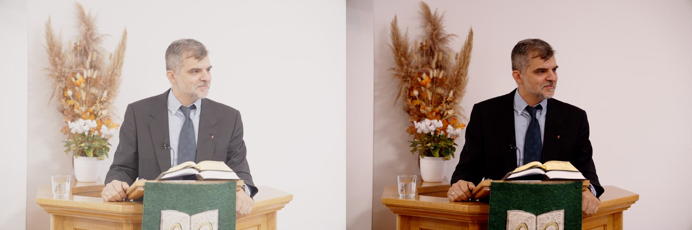
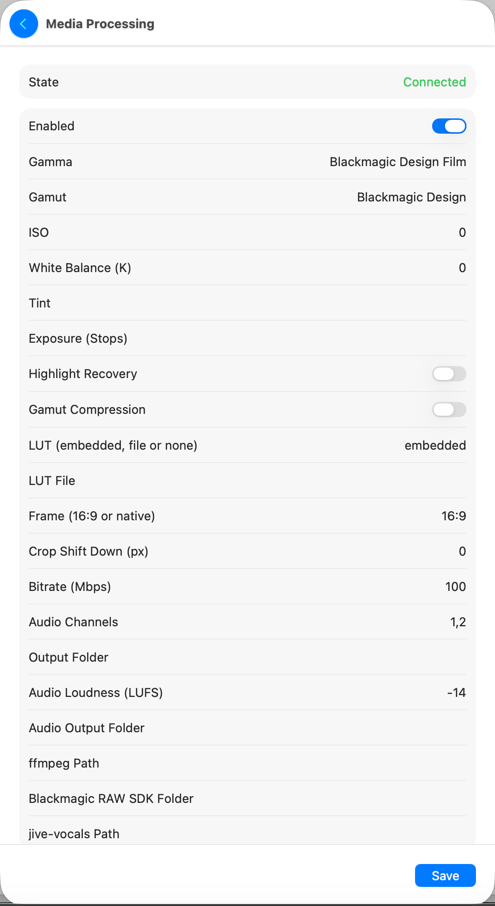

# Metocast

Church livestream control desktop application built with Tauri 2 + SvelteKit 5 + TypeScript.

## Rendering UIs

The front-end is swappable. Each rendering UI is a self-contained static app under `ui/` that
talks to the core through one package (`@metocast/core-client`) and never touches Tauri, `fetch`
or `WebSocket` directly, so the same UI runs in the desktop app, a browser, or a remote
client-mode window. This is a pnpm workspace:

```
ui/classic/            the original control surface (frozen; full coverage)
ui/sanctum/            the new Sanctum design UI
packages/core-client/  the only boundary to the core (framework-agnostic: HTTP, WS transport, Zod schemas, host, locales)
packages/design-system/ Sanctum's tokens + components (@metocast/design-system)
```

```bash
pnpm build                              # the registry's default UI (classic)
METOCAST_UI=sanctum pnpm build          # a different registered UI
METOCAST_UI=classic,sanctum pnpm build  # both, with a chooser + in-app selector
```

Registered UIs live in [`ui/registry.json`](ui/registry.json); [`ui/README.md`](ui/README.md) is
the contract for writing one and what belongs in the shared package.

## Rust workspace

The backend is a Rust 1.98.1 workspace with one-way dependencies:

```text
metocast-core          shared wire records and pure rules
├── metocast-client    typed HTTP/WebSocket client for native apps
│   └── metocast-apple UniFFI Swift bridge and XCFramework
└── metocast-server    Axum, PostgreSQL, workers, and connectors
    └── metocast       thin Tauri host in src-tauri
```

`metocast-core` is the source of truth for Rust wire types. The server owns persistence and
concrete integrations; it has no Tauri dependency. Both the desktop host and the headless
`metocast-server` binary start the same server library. The Apple client links only core/client
code and never embeds PostgreSQL or hardware connectors.

```bash
cargo build -p metocast-server --bin metocast-server
cargo test --workspace
cargo clippy --workspace --all-targets --all-features -- -D warnings
./scripts/build-apple.sh # creates apple/MetocastFFI.xcframework and runs swift test
```

When a public HTTP or WebSocket contract changes, update the core Rust record, server handler,
OpenAPI/Bruno examples, `@metocast/core-client` Zod schema, and affected native bridge record in
the same change.

## Native Apple app

`apple-app/Metocast.xcodeproj` is a SwiftUI app for iOS 26 and macOS 26 built on the `apple/`
Swift package. The Mac app is Apple Silicon only; there is no Intel build. The iPhone is a client
of a Metocast server. The Mac is either a client or the
server: its build embeds the headless `metocast-server` in `Contents/MacOS`
(`scripts/embed-apple-server.sh`), and server mode runs it, then talks to it over loopback like
any other client. Client devices connect by address and token, or by opening the
`metocast://connect` link that the Mac's Settings shows as a QR code. Every screen that hands out an address shows
both the LAN IP link and the `.local` one, each copyable; see
[web presenter and network links](docs/features/web-presenter-links.md).

```bash
./scripts/build-apple.sh   # once, and after Rust bridge changes: the app links this XCFramework
pnpm build                 # once, and after UI changes: the app ships the server's web pages
open apple-app/Metocast.xcodeproj
```

The app covers events, live production (OBS, ATEM, Middle Control, RØDECaster), slides and
presentations, connector settings and an event's recordings. **Settings → Connectors** lists every
connector and edits its configuration, with secrets that can be replaced or forgotten but never
read back; on the Mac that hosts the server, **Show Stored Secrets** reads them back through the
run's admin token over loopback. **Save** turns into **Saved** for a moment, and leaving the page
saves what was changed, with a notification if that fails. Folder fields, like the RØDECaster's
**Recording Folder**, have a folder button: on the Mac that hosts the server it opens the folder
panel, and on any other device it asks for the path on the server's Mac. **Settings → Slides & Events** has the same
button beside **Bible Slides Folder** and **Song Slides Folder** on the Mac that hosts the server;
elsewhere you type the path on the server's Mac. **Settings → Equipment → Automations** writes the
[rules that link devices](#connector-automations) and shows their run history, and the **Live** screen
carries the "Automations armed" switch, the running Middle Control preset and the RØDECaster's own SD
recorder. **Settings → Server Tools** covers the scheduled jobs, the upload
queues, the saved Broadlink commands, the OBS sources the server watches, recordings that belong
to no event, the caption overlay address and the core log. **Presentation → Open Slides** searches the server's watched folders, opens a deck in
whichever backend the server uses, and writes a song deck from pasted lyrics.

The app is in English and Hungarian and follows the device's language, or the one chosen for
Metocast alone in System Settings or the iPhone's Settings; see
[Hungarian in the Apple app](docs/features/apple-app-language.md).

On Mac, open **Settings (⌘,) → Equipment → Discover Devices** for ATEM, Blackmagic
camera, Middle Control, Broadlink, OBS device, and RØDECaster audio discovery. Scans run on
the connected server (also in client mode). ATEM and Middle Control results can fill the
connection form; manual host/port entry is available when discovery finds nothing. Save
Connection applies and enables/disables the connector using its existing API. OBS and
RØDECaster must already be connected to scan their devices. Camera discovery can automatically
adopt the first camera when unconfigured; Broadlink discovery saves devices in the background,
so its panel shows saved devices and provides a refresh button.

Building the server needs `cmake` (`brew install cmake`). The Mac app is not sandboxed, because
the server spawns PostgreSQL and listens on the network.

Every Mac build embeds `braw-decode`, so the app can develop `.braw` clips. A Mac with Blackmagic
RAW installed compiles it; anything else, GitHub's runners included, uses the committed
`braw-decode/prebuilt` build, because the SDK cannot be redistributed here — see
[The SDK on a build machine](braw-decode/README.md#the-sdk-on-a-build-machine). The framework
itself is never bundled: each Mac loads it from its own Blackmagic RAW install.

## Media processing: video and audio masters

The Mac that hosts the server turns raw service recordings into files ready to upload:

- **Video:** a graded master of the sermon from the camera's Blackmagic RAW clip (or any
  `.mov`/`.mp4`), in 6K HEVC for YouTube.
- **Audio:** a clean, level voice track from any microphone recording, kept sample-aligned with
  its source so it can be merged with the video.
- **Video + Audio:** both at once. Drop the camera clip and the microphone recording, and
  Metocast finds where in the recording the video starts and makes one file whose sound covers
  exactly the whole video.

Both keep their timing facts (camera timecode, recording start time) with the finished file, so
later steps can line audio, video and subtitles up on one timeline. Jobs run on the server's
`media` queue, one at a time. Each finished file is filed under an event, or under Unassigned
Recordings, where the upload flow picks it up.

Nothing needs installing apart from Blackmagic RAW, and only for `.braw` files. The app ships
ffmpeg and ffprobe, and fetches jive-vocals itself (see [Bundled tools](#bundled-tools)).

### The Media page

The page reads files from the server's own disk, so it appears only in the **Mac app in server
mode**: **Media** in the sidebar. Its look follows Middle Things' Middle Control: cards, `−`/`+`
value rows, and a black viewer with a bar of setting tiles.

1. **Drop the files** on the Files card (or **Open Files…**). One field takes everything:
   - the video (`.braw`, `.mov` or `.mp4`);
   - its audio recording, or every part a recorder split it into (joined in name order);
   - a transcript (`.srt` or `.vtt`) to send with the video as captions;
   - a look from Resolve: a `.sidecar` (Color page → Camera RAW → _Decode Using: Clip_ →
     **Update Sidecar**) or a `.cube` (Generate LUT).

   What runs follows from what you drop: a video with audio makes a program (synced, cleaned
   sound), audio alone makes an audio master, and a video alone asks what to do with its sound.

2. **Look at the picture.** The viewer shows the **original** (the clip as recorded: the camera's
   flat log for Blackmagic RAW) left of the split line and the **result** with the current
   settings right of it. Drag the line, or drag it to an edge to see one side whole. Scrub the
   timeline (or step with ◀ ▶, ←/→, ⇧←/→ for a second) to check any frame; the 16:9 frame the
   render keeps is outlined, and the slider on the right moves it up or down.
3. **Set the look** with the tiles under the picture: ISO, white balance, tint, exposure, gamma,
   gamut, LUT, highlight recovery and gamut compression. A tile opens a ruler you drag, or a strip
   of choices; **As Shot** goes back to what the camera recorded. The choices come from the clip
   itself, through the Blackmagic RAW SDK. ISO only offers what the clip's recorded gain allows
   (the Cinema Camera 6K has two: ISO 100–1000 and 1250 up), so use the exposure to go further. A
   saved ISO the clip can't use moves to the nearest one it offers, and the exposure makes up the
   difference. **Save as Default** keeps the look (including a Resolve
   sidecar, copied into Metocast's own folder) for every later clip.
4. Set the **Sound** and **Output** cards (voice channel, loudness, frame, bitrate), pick the
   **Event** on the Start card, and press the big button. The **Jobs** card shows every job's
   progress, with **Cancel**, **Play**, **Show in Finder**, and for programs **Audio 1 Frame
   Earlier/Later**.

Changes made on the page apply to that job only, unless you save them as the default.

### Resolve Look

The app ships **Resolve Look**: the church's DaVinci Resolve grade for the Blackmagic Cinema
Camera 6K, read from the Resolve project (`metodi.drp`). It sets the gamma to Blackmagic Design
Extended Video and the gamut to Blackmagic Design, and carries the project's Primaries node (lift
−0.12, gain 1.12, offset 33.60, shadows +8.5, highlights −9) as the sidecar's LUT.



Left: the clip without the look. Right: with Resolve Look and the recommended settings below.

To use it, open the clip on the Media page, tap the **LUT** tile and choose **Resolve Look**. These
settings are a recommendation, a starting point to adjust by eye:

| Tile       | Recommended                              |
| ---------- | ---------------------------------------- |
| ISO        | 800 (if the clip doesn't offer it: 1250) |
| WB         | 3800K                                    |
| Tint       | 21                                       |
| Exposure   | 0 at ISO 800, −0.6 at ISO 1250           |
| Gamut Comp | Off                                      |
| Highlights | Off                                      |

White balance, ISO and exposure aren't part of the look: Blackmagic RAW keys them to each clip's
own timecode, so a look made on one clip can't carry them. Choosing the look keeps the ones already
set. Press **Save Look as Default** once, and every later clip opens with the look and these
settings; on a clip that can't use the saved ISO, the nearest one is used and the exposure keeps
the brightness.

The file is `apple-app/Metocast/Looks/Resolve Look.sidecar`, copied into the app's Resources. A
look saved with the same name in `~/Library/Application Support/Metocast/Looks` takes its place.

### Video

How it works:

- **Blackmagic RAW:** [`braw-decode`](braw-decode/README.md) develops the clip on the GPU with the
  Blackmagic RAW SDK, which also applies the LUT. The original files are never changed.
- **Encoding:** ffmpeg encodes HEVC Main 10 on the Mac's media engine (`hevc_videotoolbox`), with
  BT.709 tags and the camera's start timecode. The church's Cinema Camera 6K gives
  6048×3402 for YouTube.
- **Speed:** about 11–12 frames a second on an M1 Pro, so a 29-minute sermon takes about an hour.
- **Output:** `Metocast Renders` next to the source file (or the configured folder). The source is
  often on the camera's drive, which has the room; a render takes about 45 GB per hour.

### Audio

How it works: each job has five steps.

1. **Download:** on first use only, Metocast fetches jive-vocals.
2. **Join and mix:** ffmpeg joins the files and mixes the chosen channels to one 48 kHz voice
   track.
3. **Clean:** [jive-vocals](https://github.com/linuxmatters/jive-vocals) removes rumble, hiss,
   clicks and harsh "s" sounds, evens out the level and normalises to −16 LUFS.
4. **Align:** jive-vocals' noise reduction delays the audio slightly (about 33 ms on the church's
   mic), by an amount that depends on the recording. Metocast measures the delay against the
   source at seven points through the recording. If the points don't agree, the job fails instead
   of guessing.
5. **Finish:** ffmpeg removes that delay, keeps the source's exact length, and lifts the level to
   the target with a limiter. On loud passages the limiter can leave the result slightly under the
   target, like the −14.6 LUFS in the screenshot.

The result is a 24-bit, 48 kHz Broadcast WAV with the voice on both channels, stamped with the
recording's start time, so it lines up with its source to the sample. It is saved in
`Metocast Audio` in the Music folder (or the configured folder), with jive-vocals' report next to
it (`<name>.jive-vocals.md`). A 92-minute service takes about 15 minutes on an M1 Pro.

<br clear="right">

### Video + Audio

A program is the finished sermon video in one job: the graded picture with the clean voice under
it, in sync. The video is the master, so the result is exactly as long as the video. The Sync
card says whether the video's own sound is usable (the Cinema Camera's input is unconnected
during services), how the job will sync, and where the clocks put the start. If you already know
where the video starts in the recording, type it in **Starts in Recording** (like `5:46.75`) and
the search is skipped. When it's done the job says how the audio was placed and whether Metocast
is sure.

How the sync works:

- **The video's own sound**, when it has any, is matched against the recording's: the voice's
  loudness rises and falls the same way in both. That gives a millisecond-exact position.
- **The speaker's lips**, when the video is silent. [`lip-reader`](lip-reader/README.md) measures
  how open the mouth is on every frame with Apple's on-device face model (the Vision framework;
  nothing to download). Metocast matches four 90-second stretches of that against the voice in the
  whole recording. On the church's 6K camera this found the sermon in an hour-long Wireless PRO
  recording with the minute-by-minute estimates agreeing to ±10 ms. Lips move a little before the
  sound they make, so a fixed lead (60 ms) is taken off. It still needs checking against a clip
  with true sync.
- **The clocks** only help. The camera's timecode and the recorder's file time were 3 min 50 s
  apart on 4 October, so Metocast never trusts them alone. After a confident sync it remembers the
  difference between the camera's clock and the recorder's for a week. A clip too short to place
  by its lips (under about 2 minutes) uses that difference, and the result asks you to check it.

After the sync, only the stretch of the recording the video needs (plus 2 seconds either side)
goes through jive-vocals, so the loudness is set for the sermon itself and the cleaning takes a
fraction of the time. If the audio drifts against the video (two clocks), and the drift is
clearly measured, it is corrected. Where the recording doesn't reach the video's start or end,
the program has silence, and the row says how much.

The result is two files in `Metocast Renders` next to the video: `<name>.mov` (the picture,
copied without re-encoding, with AAC 320k audio and the camera's start timecode) and `<name>.wav`
(the program's sound alone: 24-bit, 48 kHz, exactly the video's length, for subtitles or editing).

<br clear="right">

### Subtitles

A transcript dropped with the video (`.srt` or `.vtt`, one per language, such as `sermon.hu.srt`)
goes out with the program:

- **English: placed sentence by sentence on the speech.** Drop the live translation, downloaded
  from **Transcripts**, with the video (and the recording, if there is one). It can count from the
  start of the session or of the recording: Metocast finds where the program sits in it by itself.
  The live text arrives 2–6 s late and in fragments, with stray quote marks. So after the merge,
  the job:
  - rebuilds it into whole sentences, cut at a comma where one is too long for two lines;
  - runs the bundled `whisper-cli` (whisper.cpp, `large-v3`) on the program's audio. Whisper
    translates the speech to English with a time for every word. Its wording is never shown;
    it is only the clock;
  - matches the transcript's words with Whisper's, in order, and starts each caption when its
    first word is spoken.

  On the 2026-10-18 sermon this placed 239 sentence captions, 225 of them by a matched word. It
  takes about a fifth of the program's length on an M1, and the first such job downloads
  Whisper's model (3.1 GB). If Whisper can't run (no model, no `whisper-cli`) or the transcript
  doesn't match the speech, the job falls back to the voice match below.
- **Other languages: lined up with the voice.** It may be timed to the video or to the audio recording (for
  example made from the Wireless PRO file). Metocast matches where its lines are against where
  the program's voice speaks, finds the shift, and moves every line by it. If the match isn't
  clear (common for a live translation, whose lines trail the speech by varying seconds), a
  transcript that runs past the end of the program can only be timed to the recording, so it
  moves with the recording, where the sync put it; any other is left as it was. Either way the
  job says the match wasn't clear, so check it.
- **Saved beside the program** as `<name>.<language>.srt`.
- **Sent with the uploads** when the program is filed under an event: YouTube gets it as a
  caption track in its language, and Facebook gets it after the video upload. English captions
  are only generated with AI (see [Live English transcript and captions](#live-english-transcript-and-captions)) when no English
  transcript was given.

### Media processing settings



The defaults live in the `media` connector: **Settings → Connectors… → Media Processing** in the
Mac app, or `GET`/`PUT /api/connectors/media/config`. The Media page can change them for one job
without saving, or keep its look with **Save as Default**. Blank or 0 means "as shot" or
"automatic".

| Setting                   | Field                   | Default                                   | Meaning                                                                           |
| ------------------------- | ----------------------- | ----------------------------------------- | --------------------------------------------------------------------------------- |
| Enabled                   | `enabled`               | on                                        | Off refuses new jobs                                                              |
| Gamma, Gamut              | `gamma`, `gamut`        | Blackmagic Design Film, Blackmagic Design | How Blackmagic RAW is developed                                                   |
| ISO, White Balance, Tint  | `iso`, `kelvin`, `tint` | as shot                                   | Development overrides                                                             |
| Exposure                  | `exposure`              | as shot                                   | In stops                                                                          |
| Highlight Recovery        | `highlightRecovery`     | off                                       |                                                                                   |
| Gamut Compression         | `gamutCompression`      | off                                       |                                                                                   |
| LUT                       | `lutMode`, `lutPath`    | `embedded`                                | `embedded`, `file` (with a `.cube` path), `sidecar` (the sidecar's LUT) or `none` |
| Resolve Sidecar           | `sidecarPath`           | none                                      | A Blackmagic RAW `.sidecar` applied before the rest                               |
| Frame                     | `aspect`                | `16:9`                                    | `16:9` for YouTube, or `native` (the whole picture)                               |
| Crop Shift Down           | `cropShiftY`            | 0                                         | Pixels to move a 16:9 crop down (negative: up)                                    |
| Bitrate                   | `bitrateMbps`           | 100                                       | HEVC average; peaks may reach 1.4×                                                |
| Audio Channels            | `audioChannels`         | `1,2`                                     | Camera channels kept in a render                                                  |
| Output Folder             | `outputFolder`          | next to the source                        | Where renders go                                                                  |
| Audio Loudness            | `audioTargetLufs`       | −14                                       | Loudness of audio masters (−30 to −9 LUFS)                                        |
| Audio Output Folder       | `audioOutputFolder`     | `~/Music/Metocast Audio`                  | Where audio masters go                                                            |
| ffmpeg Path               | `ffmpegPath`            | the bundled copy                          | Another ffmpeg (its `ffprobe` must sit next to it)                                |
| Blackmagic RAW SDK Folder | `brawSdkPath`           | the Blackmagic RAW app                    | Where `BlackmagicRawAPI.framework` is                                             |
| jive-vocals Path          | `jiveVocalsPath`        | the downloaded copy                       | Another jive-vocals                                                               |

The defaults match the church's Blackmagic Cinema Camera 6K and its "Gen 5 Film to Extended Video"
LUT.

<br clear="right">

### Bundled tools

| Tool               | Where it comes from                                                                                                           | Licence        |
| ------------------ | ----------------------------------------------------------------------------------------------------------------------------- | -------------- |
| ffmpeg, ffprobe    | Built from FFmpeg's official 9.0.2 source when the app is built, and shipped inside the app ([details](ffmpeg/README.md))     | LGPL 2.1+      |
| braw-decode        | Built with the app where the Blackmagic RAW SDK is installed, else the committed prebuilt ([details](braw-decode/README.md)) | MIT (Metocast) |
| Blackmagic RAW SDK | The free Blackmagic RAW install; never bundled                                                                                | Blackmagic     |
| jive-vocals 0.7.0  | Downloaded from its GitHub release on first use and checked against a pinned SHA-256, like the embedded PostgreSQL            | GPL-3.0        |
| lip-reader         | Built with the app from Swift source; uses macOS's own Vision framework ([details](lip-reader/README.md))                     | MIT (Metocast) |
| whisper-cli        | Built from whisper.cpp's 1.9.5 source when the app is built, and shipped inside the app ([details](whisper/README.md))         | MIT            |
| Whisper models     | `large-v3` (3.1 GB) and Silero VAD, downloaded on first use and checked against pinned SHA-256s                               | MIT            |

Outside the app, `METOCAST_FFMPEG`, `METOCAST_BRAW_DECODE`, `METOCAST_LIP_READER` and
`METOCAST_WHISPER` point a development server at other copies.

### Media API

Every route needs the auth token (`Authorization: Bearer <token>`). The full schemas are in the
server's `/docs` (OpenAPI), and ready-made requests are in [`bruno/media`](bruno/media).

| Request                                  | What it does                                                                                                                             |
| ---------------------------------------- | ---------------------------------------------------------------------------------------------------------------------------------------- |
| `POST /api/media/probe`                  | Describes a video file: picture, timecode, camera metadata, the output frame, missing tools; `sidecarPath` reads a `.sidecar`'s settings |
| `POST /api/media/preview`                | One frame as a base64 JPEG: as recorded, or graded with `settings`; plus the crop a render keeps                                         |
| `POST /api/media/renders`                | Queues a render. Replies `202` with `{ jobId, outputPath }`                                                                              |
| `POST /api/media/audio/probe`            | Describes one or more audio files, joined in the order given                                                                             |
| `POST /api/media/audio`                  | Queues an audio master. Replies `202` with `{ jobId, outputPath }`                                                                       |
| `POST /api/media/programs/probe`         | Describes a video and its audio, the video's sound level, the sync method and the clocks                                                 |
| `POST /api/media/programs`               | Queues a program (video + synced audio). Replies `202` with `{ jobId, outputPath }`                                                      |
| `POST /api/media/programs/{id}/nudge`    | Moves a finished program's audio by `{ frames }` (positive: later)                                                                       |
| `POST /api/media/programs/{id}/subtitles` | Places `{ subtitles: [{ path, language }] }` on a finished program, as its job would have                                              |
| `POST /api/media/renders/{id}/cancel`    | Stops a queued or running job of any kind; its partial files are removed                                                                 |
| `GET /api/queues/media/jobs`             | Lists the jobs (`jobType` `render_video`, `process_audio`, `produce_program`, `nudge_program` or `subtitle_program`)                                         |
| `GET`/`PUT /api/connectors/media/config` | Reads or saves the [defaults](#media-processing-settings)                                                                                |

Errors: `400` for a relative path, an unsupported file or invalid settings; `404` for a missing
file or event; `409` when the same file is already queued; and `503` when Media Processing is off
or a tool is missing. Each reply carries `{ "error": "…" }`.

Queuing an audio master from two parts of a Wireless PRO recording, with the stored defaults:

```bash
curl -X POST "http://<server>:3737/api/media/audio" \
  -H "Authorization: Bearer $TOKEN" -H "Content-Type: application/json" \
  -d '{"paths": ["/Volumes/WirelessPRO 1/00015_Wireless_PRO.WAV",
                 "/Volumes/WirelessPRO 1/00016_Wireless_PRO.WAV"],
       "eventId": null,
       "settings": {"channels": [], "targetLufs": -14}}'
```

```json
{
  "jobId": "6f2c1f8e-9a3e-4a8b-9f6e-2d8a1b7c3e10",
  "outputPath": "/Users/…/Music/Metocast Audio/00015_Wireless_PRO.wav"
}
```

Progress arrives on the WebSocket (`/ws`), to every connected client. A render, about once a
second while it runs (example values):

```json
{
  "type": "media.render.progress",
  "progress": {
    "jobId": "6f2c1f8e-9a3e-4a8b-9f6e-2d8a1b7c3e10",
    "state": "running",
    "frame": 240,
    "totalFrames": 41412,
    "fps": 11.5,
    "outputPath": "/Volumes/A002/Metocast Renders/Untitled CAM 1 05.mov",
    "error": null
  }
}
```

An audio master, as each step starts and when it ends (the loudness figures are the excerpt's
from the screenshot above):

```json
{
  "type": "media.audio.progress",
  "progress": {
    "jobId": "0b6d0c55-3f4e-4d7a-8f63-6c1f2e9a7b21",
    "state": "succeeded",
    "step": null,
    "fraction": 1.0,
    "outputPath": "/Users/…/Music/Metocast Audio/Sunday sermon excerpt.wav",
    "error": null,
    "report": {
      "inputLufs": -41.8,
      "outputLufs": -14.6,
      "outputTruePeakDbtp": -1.4,
      "removedDelaySamples": 1582,
      "alignmentConfidence": 0.9
    }
  }
}
```

A program, when it ends (and again after each nudge), with the sync it found:

```json
{
  "type": "media.program.progress",
  "progress": {
    "jobId": "3c1e5a9f-2b7d-4e0a-9c6b-8d2f1a4e7b90",
    "state": "succeeded",
    "step": null,
    "fraction": 1.0,
    "outputPath": "/Volumes/A002/Metocast Renders/Untitled CAM 1 05.mov",
    "error": null,
    "report": {
      "sync": {
        "method": "lips",
        "offsetSeconds": 346.75,
        "driftPpm": 0.0,
        "confidence": 1.0,
        "confident": true,
        "peakSigma": 17.0,
        "windows": [
          { "videoSeconds": 396.0, "offsetSeconds": 346.739, "score": 0.23, "agrees": true }
        ],
        "clockDifferenceSeconds": 229.875,
        "clockOffsetSeconds": 576.625,
        "manualFrames": 0,
        "startFile": "00015_Wireless_PRO.WAV",
        "startFileSeconds": 346.75
      },
      "audio": {
        "inputLufs": -44.9,
        "outputLufs": -14.1,
        "outputTruePeakDbtp": -1.3,
        "removedDelaySamples": 1582,
        "alignmentConfidence": 0.9
      },
      "audioSeconds": 3600.0,
      "coverage": 1.0,
      "silentStartSeconds": 0.0,
      "silentEndSeconds": 0.0,
      "damagedFrames": 0,
      "audioOutputPath": "/Volumes/A002/Metocast Renders/Untitled CAM 1 05.wav"
    }
  }
}
```

`state` is `running`, `succeeded`, `failed` or `cancelled`. An audio job's `step` is `download`,
`prepare`, `clean`, `align` or `finish`. Its `fraction` is `null` during `clean`, because
jive-vocals reports no progress. A program's `step` is `download`, `picture`, `prepare`, `sync`,
`clean`, `merge` or `captions` (Whisper placing an English transcript, after the merge; `fraction`
is `null`). A sync `method` of `clock`, or `confident: false`, means the operator should
check the result; `manual` means the request gave `startSeconds`. `damagedFrames` counts frames at the clip's
end that a recording that didn't end cleanly left unreadable, shown as the last good frame held (see
[the media page](docs/features/media.md#a-clip-whose-end-is-damaged)).

Each finished file becomes a recording (`media_kind` `video` or `audio`). Its `metadata` holds the
settings used (`render` or `audio`), an audio master's `report`, and a `timeline` object for the
later sync and subtitle steps:

- **Renders:** the start timecode, frame rate, source file, camera and clip name, and when
  Metocast saw the camera start recording.
- **Audio masters:** the recording's start time and where it came from (`clockSource`), the
  sample rate, and the source files with their lengths.
- **Programs** (`source` `program`): the render's timeline facts plus the audio files and their
  start time. The `report` holds the sync (method, offset, drift, confidence, the windows, and the
  clock difference the next clip of the same camera learns from), the loudness and the coverage.

## Live English transcript and captions

Sermons are Hungarian; the core can translate them into English text with OpenAI's
`gpt-realtime-translate`. Set it up in the Mac app under **Settings → Connectors → OpenAI
Translation** (API key, lag, caption options). Sanctum's page for it adds a key check, top-ups and
the RØDECaster source.

- **Live:** **Live → English Transcript** in the Mac app (or Sanctum's dashboard card) starts and
  stops it for the current event, and shows the newest line. The Mac app also starts it with no
  event at all (`transcription.start` without `eventId`). It only runs while the RØDECaster is
  connected. Unplugging the desk ends the session, and the operator starts it again by hand.
  Upstream sessions last about an hour, so the core rotates the connection at a pause after 55
  minutes.
- **Viewers:** open `/transcript` on any phone (no login; it is read-only, and follows the system
  light or dark appearance). `/transcript?overlay=1` is a transparent two-line source for OBS.
- **YouTube live captions:** with **Live YouTube captions** on, new broadcasts use HTTP-POST captions
  and each line is posted to the stream's caption ingestion URL, timed to the speech. The URL is
  read from YouTube, or pasted as an override.
- **Final video:** with **Caption finished uploads** on, or `POST /api/recordings/{id}/captions`,
  the exported file is played to the model at 1×. Cue starts are snapped to speech onsets, and the
  WebVTT is uploaded as the "English" track (`captions` job queue). Download it from
  `GET /api/recordings/{id}/captions.vtt`. Uploading captions needs the `youtube.force-ssl` scope,
  so log in to YouTube again once.
- **Stored transcripts:** every session is kept in the database. **Settings → Server Tools →
  Transcripts** in the Mac app, or Sanctum's `/transcripts`, lists them and reads, downloads
  (`.txt`, `.srt`, `.vtt`) and deletes them. It can also have OpenAI clean them up after the
  service. See [docs/features/transcripts.md](docs/features/transcripts.md).
- **Credit:** with an optional admin key and the top-ups you entered, the dashboard shows
  "AI credit: $X.XX", in red below $5. It is computed from the Costs API.
- **Cost:** about $0.034 per minute of audio.
- **Developer tool:** `cargo run -p metocast-transcription --bin metocast-transcribe -- <file>`
  replays a file at live pace, with `--serve` for a browser viewer.

## Broadcast controls

Each event's YouTube broadcast and Facebook live video show in the events list as **Scheduled**,
**Starting**, **Live** or **Ended**: the platform's own state, refreshed every minute while a
service is near or on air. **Go Live** and **End** run from the list (Mac, iPhone, Sanctum, Companion, MCP)
instead of YouTube Studio or Facebook Live Producer; YouTube refuses to go live until OBS or the
encoder is streaming. `POST /api/events/{id}/stream/{youtube|facebook}/{start|stop}`, or the
WebSocket commands `events.stream.start` / `events.stream.stop`. See
[docs/features/broadcast-controls.md](docs/features/broadcast-controls.md).

## Connector automations

Metocast drives several devices, but an operator used to start each recorder by hand. **Automations**
are rules that run inside the core, so they work with no UI open, in the Mac app's server mode and in
the headless `metocast-server` alike: _when_ one device does something, Metocast _does_ something on
others. Every client sees and edits the same rules: **Settings → Equipment → Automations** in the
Apple app, or the REST API below.

A rule fires when **any** of its triggers happens and runs **all** of its actions, in order. The two
first rules:

- **Service start**: when Middle Control preset 3 finishes its move, **or** the pastor's RØDECaster
  channel goes live, move the camera to preset 3 (unless preset 3 is what fired the rule) and wait
  until it arrives, then start OBS, the ATEM, the Blackmagic camera, the RØDECaster's own SD
  recorder and Metocast's audio recording.
- **Service end**: when preset 1 finishes its move, **or** that channel goes silent, stop the same
  recorders, then (optionally) move the camera to preset 1.

| Trigger (`kind`)       | Fires when                                                                                                                                                                                                                                                                          |
| ---------------------- | ----------------------------------------------------------------------------------------------------------------------------------------------------------------------------------------------------------------------------------------------------------------------------------- |
| `middlecontrol.preset` | that preset's move has **finished**, not when it was clicked, wherever it was clicked (Middle Control's window, the APC-R, a Stream Deck). `cameraId` is optional.                                                                                                                  |
| `rodecaster.channel`   | the channel (`channel` is the zero-based fader slot) goes live or silent (`live`) and stays so for `holdSeconds` (0–60). `source` says which mute counts: `either` (default: live only while both the desk and the Wireless PRO transmitter are unmuted), `desk`, or `transmitter`. |

| Action (`kind`)                | Does                                                                                                                                                                                                                                                            |
| ------------------------------ | --------------------------------------------------------------------------------------------------------------------------------------------------------------------------------------------------------------------------------------------------------------- |
| `middlecontrol.preset.recall`  | moves a camera (`cameraId` null is the selected one) to a preset. Skipped when that same preset fired the rule. With `waitForArrival`, the actions after it wait until the camera arrives.                                                                      |
| `record.start` / `record.stop` | drives a `target`: `obs`, `atem`, `blackmagic-camera`, `middlecontrol` (cameras recorded through Middle Control; `cameraId` optional), `rodecaster` (the desk's own SD/USB recorder) or `rodecaster-audio` (Metocast's FLAC recording of the desk's USB audio). |

Rule options: `cooldownSeconds` (1–600, default 5) ignores re-fires inside the window, and
`requireEvent` fires the rule only when the server has a current event today. Limits: 50 rules, names
of 1–80 characters, presets 1–12, cameras 1–99.

**How it behaves**

- **Edge-triggered only.** Nothing fires on server start, on a reconnect or RØDECaster resync, or
  when a rule is saved: the engine seeds each channel's state from the desk's profile without
  firing, and a preset only counts if Metocast saw its move start.
- **Hold.** A channel trigger with `holdSeconds` waits, then reads the channel again; if it changed
  back, nothing happens. "Silent for at least 5 s" keeps a cough-mute from splitting the recording.
- **Idempotent.** Each recorder action reads its target's state first: starting a recorder that is
  recording, or stopping an idle one, is `skipped` (no OBS "output already active" error, no double
  toggle). Metocast's audio recording goes under the server's current event (`no event today`
  fails that one action; the others still run).
- **Order.** Actions run in the order listed, except that recorder actions next to each other start
  together (each with a 10 s timeout, so one dead device holds up none). A start rule moves the
  camera first, so recording starts on the right shot; a stop rule stops recording first, so the
  recording doesn't end on a camera move. Runs execute one at a time, so a stop can't interleave
  with a start still in flight.
- **Waiting for the camera.** Arrival is the preset's number in Middle Control's `PRES_ACTIVE`
  dropping back to 0. Middle Control runs the whole transition even when the camera is already at
  the preset, so a camera whose pan and tilt moved less than 0.5° after 1.5 s counts as arrived.
  If no move starts within 1 s, or a move runs 5 s past its transition time, the rest goes ahead
  and the run notes it; for a camera other than the selected one, the rest waits for the
  transition time (`PRES_D`). If the recall itself fails, the rest goes ahead at once.
- **Visible results.** Every run is logged (one line per action), kept in a history of the last 50
  and broadcast as `automation.run`; a run with a failure also sends a `notification` at level
  `warn`.
- **Safety.** A master **Automations armed** switch disarms everything (for a rehearsal), and each
  rule has its own enable toggle. A preset recall makes a preset finish, so rules can fire each other,
  but a rule already in the chain that caused an event does not fire again, and a chain stops after
  three rules. The per-rule cooldown is a second guard. A camera that is on air shows its move on
  the stream: Middle Control's transition time decides how smooth that looks.
- **A "goes silent" stop** fires at every long mute, such as hymns or prayers. It fits a channel
  that is live only for the part being recorded, such as the sermon; to record a whole service, stop
  on a preset or use a longer hold.
- **Run now** runs the actions immediately, ignoring the cooldown, `requireEvent` and the armed
  switch, to check a setup. It really records and really moves cameras.

**Detecting presets.** Middle Control 4.0.4 reports the running preset's _number_ in `PRES_ACTIVE`
(its API page says 1/0) and has no completion token, so Metocast follows the number from the preset
to `0` and counts a move as finished after at least 90% of the transition time `PRES_D`. A move
stopped early (`STOPPRESET`, the joystick), one already running when Metocast connected, a camera
switch mid-move and anything during Middle Control's own preset sequence do not count. The state
carries `runningPreset` (1–12, or null at rest) and `lastPreset { preset, cameraId, at }`, and
`presetMoveActive` stays, derived from it. The frames describe only the selected camera; a preset
sent to another camera is not seen.

**The RØDECaster's own recorder.** `rodecaster.record.start` / `rodecaster.record.stop` drive the
desk's SD or USB recorder (not Metocast's FLAC recording) and answer `ok` or an `error`
(`rodecaster_not_connected`, `rodecaster_no_media` when no card or drive is present). Its state
arrives as `rodecaster.record.state { status: stopped | paused | recording, mediaPresent }`.
`rcast record status|start|stop` (the `rodecaster` crate) does the same from a terminal, for the
hardware check.

**API.** Editing goes over REST, with the token like the rest of `/api`:

| Request                          | What it does                                      |
| -------------------------------- | ------------------------------------------------- |
| `GET /api/automations`           | `{ armed, automations }`                          |
| `POST /api/automations`          | creates a rule (400 `{ "error" }` for a bad rule) |
| `PUT /api/automations/{id}`      | replaces a rule                                   |
| `DELETE /api/automations/{id}`   | deletes it                                        |
| `POST /api/automations/{id}/run` | runs it now and returns the run                   |
| `GET /api/automations/runs`      | the last 50 runs                                  |
| `PUT /api/automations/armed`     | `{ armed }`, the master switch                    |

The WebSocket carries what Companion needs: the commands `automations.list`, `automations.run { id }`
and `automations.set_armed { armed }`, and the broadcasts `automations.changed { armed, automations }`
(also sent on connect to clients with the token) and `automation.run { run }`. See `/docs` and
`bruno/automations/`.

**Dry run before the first Sunday.** Unmuting the channel moves the camera to preset 3 and recording
starts when it arrives; a 2 s cough-mute stops nothing; a 6 s mute stops recording first, then moves
the camera to preset 1 if that rule has the move; clicking preset 3 in Middle Control starts
everything when the camera stops moving, not on the click; stopping preset 3 halfway starts
nothing; preset 1 stops everything; the FLACs land on the event and the SD card has its file; and
with automations disarmed, nothing happens.

## API access and secrets

The core exposes one HTTP/WebSocket API, used by the desktop app, remote client-mode UIs,
Companion and the presenter receiver alike. Access has three tiers:

| Tier                                      | Who                                                | What they get                                                                                                                                                                                                     |
| ----------------------------------------- | -------------------------------------------------- | ----------------------------------------------------------------------------------------------------------------------------------------------------------------------------------------------------------------- |
| **No credentials**                        | Anyone who can reach the port                      | `GET /health`, `/openapi.json`, `/docs`, the OBS caption overlay (`/caption`), the OAuth callback, and the UI bundle. A WebSocket may connect without a token but is limited to the read-only presenter commands. |
| **Auth token**                            | The desktop app, client-mode UIs, Companion        | Everything under `/api/*` and full WebSocket access, via `Authorization: Bearer <token>` (or `?token=` for `/ws`). The token is shown on the Connect page.                                                        |
| **Auth token + admin token, on loopback** | The desktop app hosting the server, in server mode | Reading stored upstream credentials back.                                                                                                                                                                         |
| **Nobody**                                | —                                                  | Everything else about credentials. See below.                                                                                                                                                                     |

**Upstream credentials never leave the server.** The szentiras.eu API key, YouTube client
secret, Facebook app secret, OBS and Blackmagic camera passwords, and the Discord webhook URL
are stored server-side and used only for the core's own outbound requests.
`GET /api/connectors/{name}/config` always returns them blank, with a `<field>Set` boolean
saying whether one is stored — holding the auth token is not enough to read them. When saving,
send a new value to replace a secret, leave it blank to keep the stored one, or send
`"<field>Set": false` to clear it.

The one exception is the machine actually running the server: its own desktop app can re-read a
credential it stored, via `GET /api/connectors/{name}/config/secrets`. That needs a second
admin token — regenerated every run, kept in memory, handed to the host window over Tauri IPC and
never over the network — _and_ the request must arrive on loopback. A client-mode window is
talking to someone else's core, so it never gets one, and the **Show** action stays hidden.

Full contract, including what is deliberately public and what is still open (per-device keys,
encryption at rest, TLS): [plans/PLAN-api-access-contracts.md](plans/PLAN-api-access-contracts.md).

## AI agents (MCP)

Metocast runs an MCP server at `POST /mcp`, so an agent such as Claude can do anything an operator
can, through the same code paths as the apps. It is off until switched on under **Connectors → AI
Agents (MCP)**, is loopback-only unless LAN access is allowed, honours the same bearer token, and
has a read-only mode. Setup, the tool reference and the safety notes are in
[docs/mcp/README.md](docs/mcp/README.md); the WebSocket protocol is in
[docs/api/WEBSOCKET.md](docs/api/WEBSOCKET.md).

## Hiding the computer name

For screenshots, screen shares and demos, start the server with `METOCAST_REDACT=1`. It replaces
the computer's name, the home folder (`/Users/<you>`), private LAN addresses and the access token
with placeholders in everything the server sends: REST responses, WebSocket messages and MCP
results, so the Sanctum and classic UIs, the Companion module and agents all show them. The Mac
app does the same for its own screens when launched with `-MetocastRedact YES`, and passes the
setting on to its server. It changes only what is displayed: nothing stored is altered, and paths
the server returns are placeholders, so don't act on them while it is on. Documentation
screenshots are taken that way with `scripts/docs-screenshot.sh` and checked by
`scripts/check-screenshots.swift`.

## Presenter Receiver

A standalone binary that connects to the Metocast server over WebSocket and renders slides directly on a display — no browser required. Designed for Raspberry Pi / Linux framebuffer setups or macOS secondary screens.

Presentations have two persisted designs: **Classic** and **Editorial**. Editorial uses the shared warm-black, ivory and antique-gold treatment for both imported song decks and generated Bible slides; choose it from the Presentations settings in either Tauri UI. The presenter keeps both the source SVG and extracted text for imported decks, so switching the design updates the live output immediately: Classic shows the source artwork and Editorial shows the styled text. The Mac app's slide display and its New Song preview draw the same two designs natively (Cormorant Garamond and Geist Mono ship in `apple-app/Metocast/Fonts`), so the operator's preview matches the output screen.

In Sanctum, use **Slides → + → Create song PPT**, enter a title, and paste lyrics with two empty lines between slides. Metocast keeps every entered line intact (a line of up to 150 characters is never wrapped; a longer one is treated as a paragraph and wraps inside the slide), adds a title slide and a final blank slide, and writes the generated `.pptx` into the song output folder shown in **Slides → Settings**. Bible decks continue to use their separate folder under **Settings → Event settings**.

See [presenter-receiver/PRESENTER_RECEIVER.md](presenter-receiver/PRESENTER_RECEIVER.md) for full documentation: installation, auto-start on boot, supported platforms, update instructions, and WebSocket protocol reference.

### Quick start

```bash
# Install
curl -fsSL https://raw.githubusercontent.com/UMC-Hungary/metocast/master/presenter-receiver/install.sh | bash -s -- ws://YOUR_SERVER_IP:3737/ws

# Or with authentication token
presenter-receiver ws://192.168.1.10:3737/ws --token YOUR_TOKEN

# Local development against the Tauri backend
cargo run --manifest-path presenter-receiver/Cargo.toml --bin presenter-receiver -- \
  ws://127.0.0.1:3737/ws --token YOUR_TOKEN
```

## Companion Module

The Companion module communicates with Metocast only through the app WebSocket. Its Textus and Lekcio presets call `presenter.load_bible_reference` without an `event_id`, so the backend-selected current/next event is used.
The active Classic/Editorial presenter design is selected in Metocast and is applied automatically when Companion opens a text-mode song or Bible presentation.

OBS streaming and recording are started and stopped with the authenticated WebSocket commands
`obs.stream.start`/`stop` and `obs.record.start`/`stop`. Each replies `ok` or an `error` (`obs_not_connected`
when OBS is not connected); the new state then arrives as `connector.state` (`connector: "obs"`).

RØDECaster audio capture is core-owned and uses the authenticated WebSocket commands
`rodecaster.audio.discover`, `rodecaster.audio.record.start` (with `event_id`, or without it),
`rodecaster.audio.record.stop`, and `rodecaster.audio.record.state`. It writes lossless FLAC files
through `.partial` paths, atomically finalizes them, and records source/mapping provenance on the
event media row. A recording started without an event is filed as untracked recordings when it
stops, and assigning one to an event later (`POST /api/recordings/untracked/{id}/assign`) keeps its
provenance. The recording must be switched on (**Record Audio**) and given a folder on the server's
Mac, in Sanctum or in the Mac app under **Settings → Connectors → RØDECaster**; saving the connector
without those fields keeps what was stored.

Automations are controlled from Companion through the same WebSocket (`automations.list`,
`automations.run`, `automations.set_armed`): the actions **Automations: Arm / Disarm** (arm, disarm or
toggle the master switch), **Automations: Run** (a rule picked by name from the list the core sends
on connect and after every change) and **RØDECaster SD: Start/Stop Recording**; the feedbacks
**Automations: Armed** and **RØDECaster SD: Recording**; and the variables `automations_armed`
(`ON`/`OFF`) and `last_automation` (`Service start: ok` or `Service start: 2 failed`). The module has
presets for them under **Automations**. Preset buttons on a Stream Deck stay on Middle Things' own
module: Metocast sees those presets in Middle Control's feedback, so rules fire on them without
Companion's involvement.

The RØDECaster's own SD/USB recorder is a separate thing from that FLAC capture:
`rodecaster.record.start` and `rodecaster.record.stop` drive it (`rodecaster_no_media` when no card or
drive is present) and `rodecaster.record.state` reports `{ status, mediaPresent }`.

The RØDECaster channel profile keeps the mixer's `mute` separate from the Wireless PRO
transmitter's `wirelessMute`. Live `rodecaster.mute` events identify transmitter-button changes
with `remote: true`; the UI flags those as **Remote mic muted** without changing the channel toggle.

Middle Control connects over its line-oriented TCP External API and remains the sole transport to
APC-R / APC-R Mini units. Its host and port are configured under Connectors (current macOS default
`11584`, observed Middle Control 3.2.0 macOS `11581`, Windows `11580`). The shared WebSocket accepts
typed `middlecontrol.camera.select`, `middlecontrol.record.start`/`stop`,
`middlecontrol.record.start_all`/`stop_all`, and `middlecontrol.preset.recall` commands; live camera,
recording, APC-R presence, and preset-move state arrive in `connector.state` messages (`runningPreset`
is the preset moving the selected camera, `lastPreset` the last move Metocast saw finish). Use
`localhost` when Middle Control runs on the Metocast server computer. The authenticated
`POST /api/connectors/middlecontrol/discover` scan checks localhost and the server's local `/24` on
the known ports, and returns only endpoints that send a valid Middle Control feedback frame.

The Blackmagic ATEM connector speaks the switcher's UDP control protocol (default port `9910`) and
was verified against an ATEM Mini Pro (protocol 2.31). Enable it under Connectors with the
switcher's IP address, or find it with the authenticated `POST /api/connectors/atem/discover`,
which browses mDNS for `_switcher_ctrl._udp` and finds switchers both on the LAN and plugged into
the server by USB (the switcher's USB-C port brings up a USB Ethernet link that carries the same
protocol; those results are flagged `usb: true`). Program, preview, input labels, streaming and recording state arrive
unprompted in `connector.state` messages (`connector: "atem"`, `state: {…}`); models without a
streaming or recording engine report those as `null`. The shared WebSocket accepts
`atem.program.set` / `atem.preview.set` (with `input`), `atem.cut`, `atem.auto`,
`atem.record.start`/`stop`, `atem.stream.start`/`stop`, and `atem.stream.push_youtube`.
`POST /api/connectors/atem/stream/youtube` writes the channel's ingestion address and stream key into
the switcher's streaming service without going live.

## Development

```bash
pnpm dev              # Vite dev server only (port 1420)
pnpm tauri dev        # Full Tauri desktop app in dev mode
pnpm tauri build      # Production build
pnpm build:server     # Headless server binary (target/debug/metocast-server)
pnpm check            # TypeScript + Svelte type checking
```

### Plans

Plans for new work are [GitHub issues](https://github.com/UMC-Hungary/metocast/issues), not files
in the repository: the problem, the approach, the steps and what "done" means, discussed there
and linked from the pull request that carries the plan out. For example,
[#33](https://github.com/UMC-Hungary/metocast/issues/33) places dropped live transcripts on a
program with local Whisper. The `plans/` folder is ignored by git; the older notes some
sections link to live only on the machines that wrote them.
