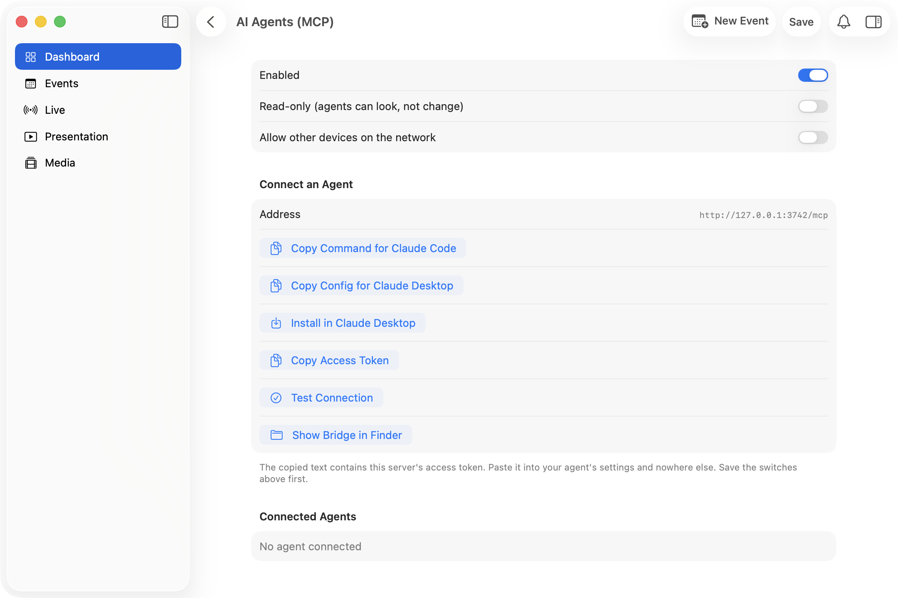

# Metocast for AI agents (MCP)

Metocast runs a [Model Context Protocol](https://modelcontextprotocol.io) server, so an agent such
as Claude can do anything an operator can: read events and recordings, move cameras, switch the
ATEM, start a render, change what is on the presenter. It lives inside the core, at
`POST /mcp` on the same port as the API, and every tool runs the code the apps already use.

- [Tool reference](TOOLS.md): every tool, what it needs, whether it reads, writes or is destructive.
- [WebSocket protocol](../api/WEBSOCKET.md): the commands and push messages behind the tools.

## Turn it on

It is **off** until the operator turns it on, because an agent can start a stream.

In the Mac app: **Connectors → AI Agents (MCP)**.



| Switch                             | Meaning                                                                                     |
| ---------------------------------- | ------------------------------------------------------------------------------------------- |
| Enabled                            | Accept MCP calls. Off answers `503`.                                                        |
| Read-only                          | Agents see only tools that change nothing, and a call to any other tool is refused.         |
| Allow other devices on the network | Off: only callers on this Mac (loopback) are accepted. On: any device that holds the token. |

The same switches are `GET`/`PUT /api/connectors/mcp/config`
(`{"enabled": true, "readOnly": false, "allowLan": false}`).

## Connect a client

The address is `http://127.0.0.1:3737/mcp` (use the server's port). Authentication is the same
bearer token as the API, in the `Authorization` header. The token stays the same across restarts
until the operator rotates it, so a saved config keeps working.

The Mac app's **Connect an Agent** section has a button for each of these.

**Claude Code** speaks HTTP, so it connects to the address directly:

```bash
claude mcp add --transport http metocast http://127.0.0.1:3737/mcp \
  --header "Authorization: Bearer <token>"
```

**Claude Desktop on a Mac** (and any client that can only start a program) connects through the
bridge inside the Metocast app, `metocast-server mcp-stdio`. It needs no Node, Python or Docker.
Turn **Enabled** on, then choose one:

- **Install in Claude Desktop** opens the extension that ships in the app. Claude asks for the
  access token: **Copy Access Token**, paste, done.
- **Copy Config for Claude Desktop** copies a config for Claude Desktop's settings (Developer, Edit
  Config). It names the bridge and carries the token in `env`:

  ```json
  {
    "mcpServers": {
      "metocast": {
        "command": "/Users/<you>/Library/Application Support/Metocast/mcp/metocast-mcp",
        "args": ["mcp-stdio"],
        "env": {
          "METOCAST_MCP_URL": "http://127.0.0.1:3737/mcp",
          "METOCAST_MCP_TOKEN": "<token>"
        }
      }
    }
  }
  ```

**Test Connection** in the same screen runs the bridge's own check and says in one line whether
Metocast answers. How the bridge works, its settings and every message it can show are in
[BRIDGE.md](BRIDGE.md).

**Other computers.** The bridge ships in the Mac app only. On Windows or Linux, clients that speak
HTTP need nothing, and stdio-only clients can use
[`mcp-remote`](https://www.npmjs.com/package/mcp-remote), which needs Node:

```json
{
  "mcpServers": {
    "metocast": {
      "command": "npx",
      "args": [
        "-y",
        "mcp-remote",
        "http://127.0.0.1:3737/mcp",
        "--header",
        "Authorization:${AUTH_HEADER}"
      ],
      "env": { "AUTH_HEADER": "Bearer <token>" }
    }
  }
}
```

**Anything else** can speak JSON-RPC directly: `POST /mcp` with `Content-Type: application/json`
and `Accept: application/json, text/event-stream`. Send `initialize` first and pass the returned
`Mcp-Session-Id` header on later calls. Every reply is plain JSON. `GET /mcp` with
`Accept: text/event-stream` and the session id opens a server-sent stream that carries resource
update notifications (see Subscriptions below); a `GET` without that answers `405`.

## What an agent gets

- **Tools** for every REST operation and every WebSocket command, one per operation, named like
  `events_create`, `obs_stream_start`, `media_renders_start`. Each carries `readOnlyHint`,
  `destructiveHint` and `idempotentHint`. Inputs are JSON Schema taken from the code.
- **`events_poll`** for what changed: connector status, event and recording changes, upload
  progress, notifications, transcript lines. Pass the `next` cursor from the last call back as
  `since`, and `wait_ms` to wait for something new. Message types are listed in
  [WEBSOCKET.md](../api/WEBSOCKET.md). Events are buffered while at least one agent is connected;
  the last 500 are kept.
- **State resources** for the current picture, readable at any time:
  `metocast://state/connectors`, `connector-status`, `presenter`, `presentation`,
  `transcription`, `queues`, `clients`, `events`, and the template
  `metocast://state/events/{id}`. They stay available in read-only mode.
- **Subscriptions.** A client that supports them can `resources/subscribe` to a state resource
  and receives `notifications/resources/updated` over the server-sent stream (`GET /mcp` with
  `Accept: text/event-stream` and the `Mcp-Session-Id`). The notification says the resource
  changed; read it again for the new value. Clients without subscriptions use `events_poll`.
- **Manual resources**: `metocast://docs/openapi.json`, `metocast://docs/websocket.md`,
  `metocast://docs/mcp-tools.md`, and a guide per feature at `metocast://docs/features/{name}.md`
  (`mcp`, `media`, `connector-automations`).
- **Prompts** that walk through routines and name the tools to use: `prepare_service`
  (`event_id`, optional), `go_live_checklist`, and `post_service_upload` (`event_id`). They read
  first and ask before anything goes on air.
- **Visibility**: every connected agent shows up as `MCP · <client name>` in the app's Connected
  Devices list.

Not exposed: the route that reveals stored credentials, the two stream-key reads, the OAuth
callback, the OBS browser-source pages and the socket lifecycle messages. The full list is at the
end of [TOOLS.md](TOOLS.md).

## Safety

Agents act on a live broadcast. Tools that stop or start a stream, stop a recording, delete
something or transmit an IR command are marked `destructiveHint: true`; a client that asks for
confirmation on those will do so. Turn on **Read-only** to let an agent observe without touching
anything.

Upstream credentials (API keys, OAuth secrets, passwords) never come back through MCP: reading a
connector's config returns secrets blank, exactly as the REST API does. The YouTube and Facebook
stream keys are left out too, so they don't end up in an agent's transcript; the tools that send a
key on (`connectors_youtube_schedule`, the `push_youtube` tools) work without showing it.

Calls are checked against the same bearer token as `/api`. With LAN access off, a request from
another machine, or from a web page with a non-local `Origin`, is refused. An agent can't change
these switches: `connectors_config_set` refuses the `mcp` connector.

## Screenshots and demos

With `METOCAST_REDACT=1` the server replaces the computer name, home folder, LAN addresses and
tokens in tool results and resources too (see [the main README](../../README.md#hiding-the-computer-name)).
The copy buttons in the Mac app still copy the real token: they are meant for pasting into an
agent, not for showing.

## Troubleshooting

| You see                                       | Cause                                                                                    |
| --------------------------------------------- | ---------------------------------------------------------------------------------------- |
| `503` "MCP is turned off"                     | Turn on **Enabled** in Connectors → AI Agents (MCP).                                     |
| `401`                                         | Missing or wrong token. Copy it again from the app; rotating it invalidates old configs. |
| `403` "only accepts callers on this machine"  | The client is on another device. Turn on **Allow other devices on the network**.         |
| `404` "Unknown session"                       | The server restarted. The client should send `initialize` again (the bridge does it).    |
| Claude Desktop shows "not running" or "token" | The bridge's own messages; see the table in [BRIDGE.md](BRIDGE.md).                      |
| A tool answers `isError` with "read-only"     | **Read-only** is on.                                                                     |
| A tool is missing                             | Keynote tools exist only on macOS builds; check [TOOLS.md](TOOLS.md).                    |

## How it is built (for maintainers)

`crates/metocast-server/src/server/mcp.rs`.

- **The stdio bridge** for Claude Desktop is `metocast-server mcp-stdio` (`crates/metocast-mcp-bridge`).
  A change to the protocol or to session handling here must keep it and
  `e2e/mcp/stdio-bridge.test.ts` passing; see [BRIDGE.md](BRIDGE.md).
- **REST tools** build an HTTP request and call the real `/api` router in-process, so auth,
  validation and error bodies are the REST ones. Their input schemas come from
  `server/openapi.rs`; a route the hand-written spec lacks gets a summary-only stub from the
  catalogue (`REST` in `mcp.rs`), which is also what makes the spec list every route.
- **WebSocket tools** deserialize into `WsCommand` and run `handle_ws_command` with a private
  channel, then return what it sent back. Schemas come from `schemars` on `WsCommand`, so a new
  command becomes a tool with no further wiring.
- Where a REST route and a WebSocket command do the same thing there is one tool. A catalogue row
  whose tool name contains a `.` is the WebSocket command it shares.
- `mcp_covers_everything` fails when a route in `server/mod.rs` has neither a catalogue row nor an
  entry in `EXCLUDED`. `openapi_covers_router` and `ws_events_catalogued` guard the spec and
  `server/ws_events.rs`; `e2e/ws/event-payloads.test.ts` checks the messages a live server sends
  against `docs/api/ws-events.schema.json`. Regenerate the generated files with
  `UPDATE_GOLDEN=1 cargo test -p metocast-server --lib`.

Plans and decisions: [plans/PLAN-mcp-server.md](../../plans/PLAN-mcp-server.md) and
[plans/PLAN-mcp-stdio-bridge.md](../../plans/PLAN-mcp-stdio-bridge.md).
